

  

  &nbsp;
  &nbsp;
  

  <picture>
    <source media="(prefers-color-scheme: dark)" srcset="./divider-01-dark.svg">
    
  </picture>

  

  <picture>
    <source media="(prefers-color-scheme: dark)" srcset="./divider-02-dark.svg">
    
  </picture>

  

  <b>ASK ME ABOUT</b> &nbsp;·&nbsp; JavaScript &nbsp;·&nbsp; React &nbsp;·&nbsp; Node.js &nbsp;·&nbsp; Socket.IO &nbsp;·&nbsp; WebRTC &nbsp;·&nbsp; Three.js &nbsp;·&nbsp; interactive experiences

  <picture>
    <source media="(prefers-color-scheme: dark)" srcset="./divider-03-dark.svg">
    
  </picture>

  

  <picture>
    <source media="(prefers-color-scheme: dark)" srcset="./divider-04-dark.svg">
    
  </picture>

  
  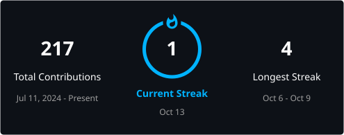

  
  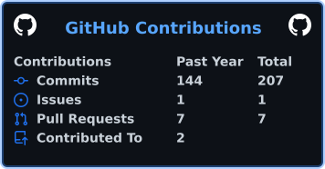

  

  

  <picture>
    <source media="(prefers-color-scheme: dark)" srcset="./divider-05-dark.svg">
    
  </picture>

  <picture>
    <source media="(prefers-color-scheme: dark)" srcset="https://raw.githubusercontent.com/EXCALIBUR-cmd/EXCALIBUR-cmd/output/github-contribution-grid-snake-dark.svg">
    
  </picture>

  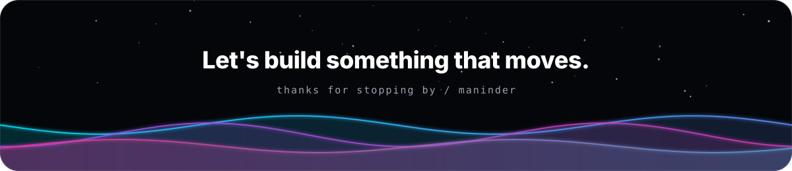

  

